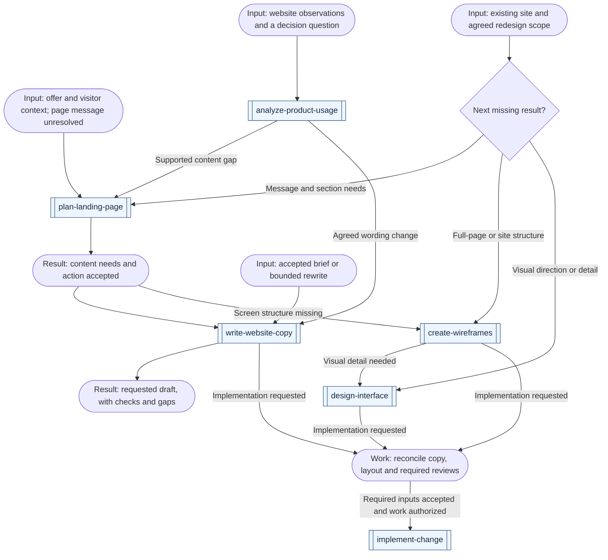
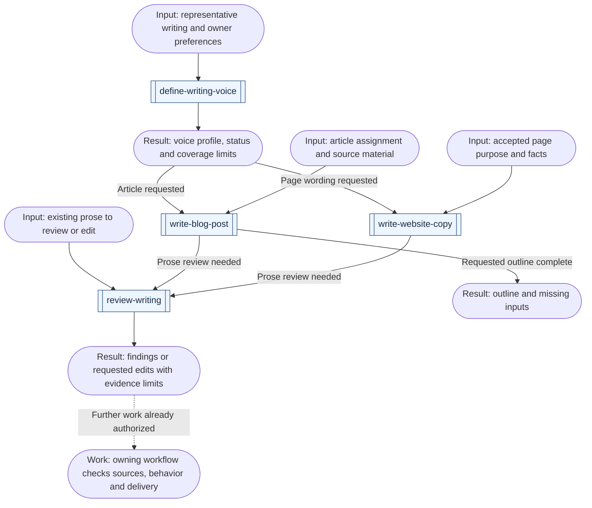

# Content workflows

[All workflows](../workflows.md) · [All content skills](../domains/content.md)

Start from the page purpose, source material or existing draft. These routes show when wording hands off to design and when a writing task can finish on its own. Double-bordered boxes name skills; rounded boxes show inputs, work or results; diamonds are decisions. Reuse completed stages and follow only the branches your result needs.

## Plan and write a product page

| Example request | First skill | Result and conditional continuation |
| --- | --- | --- |
| "What should this new product landing page say and prove?" | [plan-landing-page](../../skills/content/plan-landing-page/SKILL.md) | A content plan from the offer, audience and evidence; unresolved demand belongs to product validation, accepted content needs can move to copy or wireframes |
| "Improve this existing homepage without losing its customer and partner paths." | [plan-landing-page](../../skills/content/plan-landing-page/SKILL.md) | Inspect current content and destinations, preserve useful paths, and propose supported changes without imposing a campaign-page template |
| "Write the page copy from this accepted brief and product demonstration." | [write-website-copy](../../skills/content/write-website-copy/SKILL.md) | Actual wording with claim sources and exact gaps; reconcile text with the layout before implementation |
| "Rewrite only this hero in my voice, with a clearer opening hook." | [write-website-copy](../../skills/content/write-website-copy/SKILL.md) | A bounded rewrite preserving meaning and verified promises; no mandatory full-page plan or fixed variant count |
| "Wireframe the complete product website, including pricing and support paths." | [create-wireframes](../../skills/ui-ux/create-wireframes/SKILL.md) | Named page/template and state coverage with full-page content; preserve accepted destinations, inspect the complete scroll and report omitted surfaces |
| "Replace this site's visual direction while keeping its working content and routes." | [design-interface](../../skills/ui-ux/design-interface/SKILL.md) | An explicit preservation/change scope, evidence-based visual direction and inspected candidate; content or structural gaps use their existing owners |
| "Our one-page site has high bounce and zero visit duration; what does that tell us?" | [analyze-product-usage](../../skills/product/analyze-product-usage/SKILL.md) | Provider definitions, instrumentation and observed outcomes before diagnosis; do not infer bots or failed copy from these signals alone |

These arrows are possible handoffs. Start at the missing result, and stop at the requested output. Copy and screen structure can develop in parallel after their shared content requirements and action are accepted; reconcile both before implementation.

An existing layout can go directly to wording; a plan-only request ends before copywriting. Use `map-user-flows` for unsettled journeys, `write-interface-copy` for form and state messages, and `test-usability` when understanding needs participant evidence. The usual verification, independent review and authorized delivery route applies to implementation. A better draft does not prove a conversion increase; measurement definitions, experiment planning and readout retain their existing owners.

For an existing-site redesign, inspect the current routes, page templates, content, working actions and visual rules first. Agree what should improve and what must survive. An evidence-gathering request can start with `review-interface`; an already-agreed redesign can inspect its baseline within the owning design skill. Do not require a new audit report for every restyling task.

Use `capture-design-reference` when a supplied reference needs analysis. Record the specific pattern, source/state, why it fits this product and where it does not; an inspiration pack does not replace the target's requirements or grant rights to copy assets. Reuse available components and accepted content. Content planning records why each section exists and the question it answers; copywriting supplies the words; wireframes place all in-scope content and states; visual design resolves composition and craft.

When independent copy and layout work share accepted inputs, they may proceed together, then reconcile actual text fit and action meaning. Review the combined rendered experience, including full-page and preserved-path coverage, before authorized delivery. Evaluate behavioral explanations as hypotheses: a clean layout or persuasive section sequence cannot establish what users understand, feel or do. Keep useful decisions and reference provenance in the existing design record.

## Draft and review writing

| Example request | First skill | Result and conditional continuation |
| --- | --- | --- |
| "Turn these project notes into a blog post in my voice." | [write-blog-post](../../skills/content/write-blog-post/SKILL.md) | A supported draft with missing facts identified; use writing review for prose quality and the destination's checks for an integrated post |
| "Analyze my blog and these posts, then document how I write." | [define-writing-voice](../../skills/content/define-writing-voice/SKILL.md) | A guide in the existing authoritative location or `docs/voice.md`, with inspected samples, concrete conventions, tone by context and unresolved preferences |
| "Give me only an outline for this tutorial." | [write-blog-post](../../skills/content/write-blog-post/SKILL.md) | The requested outline and source gaps; stop before writing or publishing the article |
| "Does this paragraph sound AI-written? Flag problems without rewriting." | [review-writing](../../skills/content/review-writing/SKILL.md) | Quoted textual problems and useful repairs, or no supported findings; no authorship verdict or whole-draft rewrite |
| "Cut the generic praise from this draft but keep my voice." | [review-writing](../../skills/content/review-writing/SKILL.md) | The requested revision, retained meaning and brief reasons for material edits |
| "Make this PR description clearer without hiding the migration risk." | [explain-pr](../../skills/engineering/explain-pr/SKILL.md) | An explanation from the fixed comparison and evidence; use `review-writing` for prose cleanup while preserving risk and proof gaps |
| "Polish this status update; the deployment is still unverified." | [report-project-status](../../skills/productivity/report-project-status/SKILL.md) | An evidence-backed update that retains the unknown deployment state; writing review cannot improve its completion status |

These are possible handoffs, not mandatory stages. A small correction can finish in its owner. A writing review that satisfies the owning skill's prose criteria can be reused in its independent assessment; source, behavior and delivery checks still apply.

Detailed anti-pattern checks live in `review-writing`, without treating punctuation, technical terms or useful uncertainty as automatic defects. A draft stays within the requested scope; an article, copy edit or critique does not authorize publication. With no independent reviewer available, retain the unreviewed status instead of presenting an author check as independent proof.

A voice profile is reusable context, not a mandatory stage for each paragraph. Writers first reuse the applicable guide and sample text. When the requested voice is unknown, ask for a representative passage, blog/post URL or social account and what the owner wants to retain or change. Inspect accessible supplied sources and state coverage; a whole-blog request does not justify claiming every page was read. Keep the profile in the consuming project's docs and pass its path, status, language and channel forward. A personal or brand preference needs the owner's input; an agent can propose and check a guide without inventing approval.

