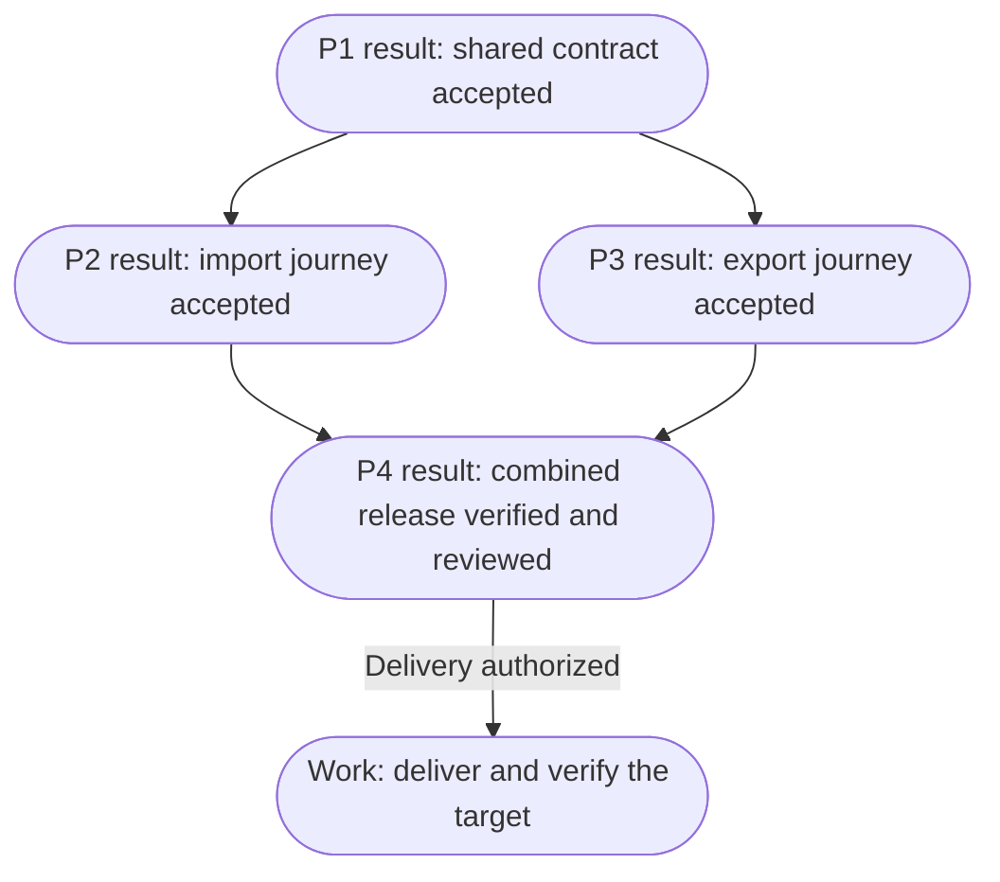
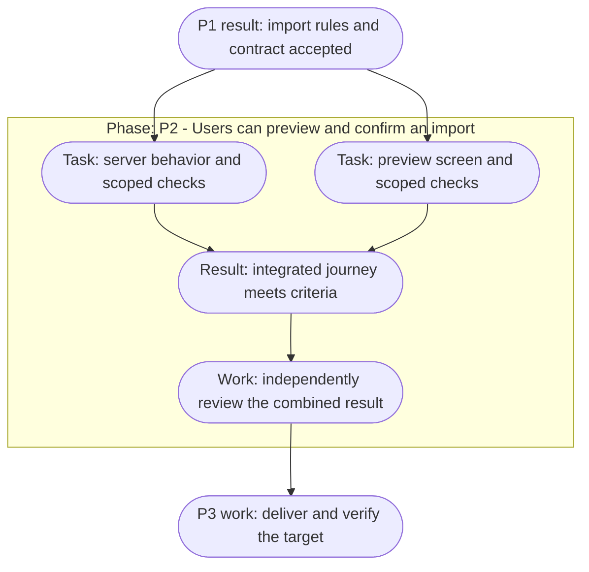

# Coordinating work across skills

[All workflows](../workflows.md)

Use this reference when a task spans stages, workers or sessions. For a single bounded result, start directly with its owning skill.

## Stages and project phases

Research, planning, implementation, verification, delivery and operation are lifecycle stages. A **delivery phase** is a milestone inside a particular project, such as “users can preview an import.” `plan-phases` creates those project milestones; it does not require a task to traverse every lifecycle stage. `create-tasks` creates work items, not skills.

The domain catalogs organize skills by responsibility. These stages organize a particular piece of work, so a stage can use skills from more than one domain:

| Stage | Useful skills | Ready to move on when |
| --- | --- | --- |
| Understand the starting point | `assess-request`, `onboard-codebase`, `explain-codebase`, `diagnose-issue` | The requested outcome and relevant baseline are understood |
| Explore and challenge | `brainstorm-ideas`, `challenge-proposal`, `research-topic`, `capture-design-reference`, `build-prototype` | Consequential choices have answers and required premises have evidence |
| Evaluate a product opportunity | `validate-product-idea`, `analyze-user-feedback`, `analyze-competitors` | The next commitment has relevant evidence, or the decision is to stop, revise or investigate further |
| Define success and experiments | `define-product-metrics`, `plan-product-experiment` | Measures or an experiment protocol have their required definitions and explicit readiness gaps; a protocol alone does not authorize launch |
| Specify and design | `write-spec`, `model-domain`, `design-architecture`, `map-user-flows`, `plan-landing-page`, `write-website-copy`, `create-wireframes`, `design-interface`, `write-interface-copy` | Behavior and the decisions needed by the selected work are accepted |
| Plan and coordinate execution | `prioritize-work`, `plan-phases`, `create-tasks`, `manage-project-board` | The selected work fits its stated constraints and has accepted prerequisites, owners and checks |
| Build | `start-project`, `implement-change` and the relevant specialist skill | The selected result exists with scoped proof on its actual revision |
| Evaluate | `verify-change`, `review-code`, `review-interface`, `review-writing`, `test-usability` | Required evidence and independent evaluation cover the selected criteria; a planned user study still awaits observations |
| Deliver and observe | `ship-change`, `configure-monitoring`, `report-project-status` | The requested delivery, monitoring configuration or status result has its scoped evidence; none promises ongoing operation |
| Learn and improve | `analyze-product-usage`, `find-improvements`, `improve-team-workflow`, `document-project`, `automate-code-checks` | Useful findings are recorded or become a justified next change; no follow-up is also valid |

Start at the stage that matches the request. The table names alternatives, not a list of skills to run at every stage. Evaluation also applies to a plan or design before its consumers rely on it.

A spec can include intended delivery slices and known dependencies when they explain scope or rollout. `plan-phases` owns the detailed milestone graph; `create-tasks` owns executable dependencies. During brainstorming, ordering and parallelism are hypotheses until the relevant behavior and shared contracts are agreed. Reuse one authoritative document or tracker where possible, rather than copying the same requirements into several files.

## Sequential and parallel work

Sequence work when one result determines another task's input. Required domain rules precede dependent contracts; shared schemas/foundations precede consumers; accepted behavior precedes its executable tasks; integration and relevant verification precede delivery.

`plan-phases` identifies which milestones can overlap and what closes each one. `create-tasks` preserves those dependencies while splitting a selected phase into owned, verifiable work. Distinguish work that could run together after named prerequisites from work ready now. A phase may start only when its own prerequisites hold; a task inside it may still wait on another task. Publish to the requested project-management destination only after checking existing work and granted write authority; reconcile uncertain writes before retrying and confirm stored results before claiming synchronization.

Parallel work needs ready inputs, independently checkable outputs, and isolated writes/state/data/verification environments. Different filenames alone do not establish independence. Read-only specialist investigations or reviews can run together on a fixed baseline. UI and technical design can run together once shared behavior is clear, with reconciliation before their consumers are implemented.

### Parallel project phases

For example, an agreed import/export release can have two capability phases after its shared data and permission contract is accepted. Each branch owns a usable outcome with its own implementation, verification and independent review. These rounded nodes are phase outcomes, and every arrow is a prerequisite; none is a skill invocation:

P2 and P3 are parallel candidates only if their owned writes and test resources can be isolated and neither needs the other's output. If export depends on the new import behavior, add that dependency and run them sequentially. P4 waits for both accepted outputs, then checks cross-capability behavior on the combined revision. A failed P2 blocks P4 but need not stop independent P3 work. Preserve P3's accepted evidence unless later changes invalidate it.

### Parallel tasks within a phase

A CSV import can also have parallel tasks inside one capability phase. These rounded nodes describe work and results, with prerequisite arrows; the frame is the phase boundary. This is a dependency illustration, not a declaration that any phase or task is already accepted:

The server and screen tasks are parallel candidates after P1 is accepted. The screen can use contract fixtures while the server is built, provided workspaces, shared files and test state do not conflict. If both tasks edit the same generated client or reset the same database, assign that shared change to one owner or serialize it. P2 exits only after both branches integrate and their combined behavior is independently accepted; fixture-based checks cannot replace that evidence.

`create-tasks` makes the same dependencies concrete inside each selected phase: a migration precedes queries that require its schema; two read-only reviews of a fixed revision can overlap; a PR requiring both branches waits for their integrated evidence. Planning a future parallel branch does not make it ready to run today.

The coordinator owns shared decisions, reconciliation, integration, and readiness. Use host-supported workers/workspaces when available; Markdown instructions do not implement a scheduler. Small work remains sequential when delegation adds no useful independence.

When independent evaluation is required, use a separate agent in fresh context, including for consequential plans, research, code, and designs. Supply accepted criteria, the fixed candidate, relevant raw sources, and check access without the author's conversation or preferred conclusion. The reviewer tries to disprove material claims and inspects actual proof. Add reviewers only for distinct risks; preserve demonstrated defects through reconciliation and independently recheck affected results after fixes. Without an independent reviewer, the result remains unreviewed and cannot pass acceptance. This is separate from the user's required decisions and approvals.

A worker may not receive the parent conversation. Give it a bounded question or outcome, source scope/baseline, applicable instructions, accepted criteria, permitted actions and owned writes, expected evidence, and stop conditions. Research returns located findings and unresolved claims; the coordinator checks consequential evidence before adopting conclusions. Use host controls where available: separate context does not establish isolation of files, services, or credentials.

## Context and next actions

Pass the accepted objective, relevant artifacts and their versions where material, decisions, scope, repository revision/baseline, unresolved prerequisites, and verification evidence. Reconcile copied task criteria with authoritative inputs after a change; retain unaffected discoveries. For partial batches, preserve each task's outputs and actual disposition, stop dependent work when its prerequisite fails, and resume from observed state. Integration needs evidence for the combined revision.

Finish with the next useful action, the skill that owns it, the input to carry forward, and any unmet prerequisite. Select the next missing result instead of reciting the whole pipeline. For example: "P1's import contract is accepted; run `create-tasks` for P2 using its preview/confirm criteria. Implementation waits until the required test environment is available." If the requested result is complete and no follow-up is justified, say so.

Before context loss or an actual session transfer, condense those facts into the existing work record or a short continuation block, retaining pending operation IDs and useful file/symbol pointers. Remove repeated logs and search noise; retain authority, blockers and unchecked criteria. On resumption, reload applicable instructions and compare against current sources/state. Summaries guide that check; they do not replace evidence or require a new document or session.

| Current result | Next skill when needed | Carry forward / prerequisite |
| --- | --- | --- |
| Idea with a consequential choice unresolved | `challenge-proposal` | Options, accepted answers and the decision that changes the outcome |
| Proposal depends on an unsupported premise | `research-topic` or `build-prototype` | The falsifiable question and the evidence needed; resume the affected proposal afterward |
| Product or feature commitment depends on unproven need or demand | `validate-product-idea` | Intended users, proposed commitment, existing evidence and its limits |
| Feedback synthesis or competitor comparison | `validate-product-idea`, `prioritize-work`, or finish according to the requested decision | Source-linked findings and counterevidence; prioritization additionally needs work candidates, goals and capacity |
| Accepted outcome needing success measures | `define-product-metrics` | Decision, user outcome, existing definitions and source constraints |
| Product hypothesis needing a controlled comparison | `plan-product-experiment` | Accepted measures, variant behavior, eligible units and source constraints; missing feasibility inputs stay explicit |
| Experiment observations | `analyze-product-usage` | Fixed protocol, changes after exposure, assignment and outcome data, maturity and harm rules |
| Measurement contract with usable observations | `analyze-product-usage` | Definition/version, eligible entity and window, source/identity rules, exclusions and data-quality checks |
| Usage finding with a consequential gap | `define-product-metrics` for unclear semantics, `implement-change` for an accepted tracking repair, or `validate-product-idea` for an investment decision | Reproducible results, source coverage, counterevidence and the unresolved question |
| Selected idea with enough evidence | `write-spec` | Accepted direction, constraints and supporting evidence |
| Spec with unresolved technical or journey choices | `design-architecture` or `map-user-flows` | Relevant behavior criteria; use `build-prototype` for unproven feasibility |
| Accepted flow or existing screen with unresolved structure | `create-wireframes` | Accepted behavior, current screens/components, supported surfaces and the structural question |
| Accepted screen structure needing visual detail | `design-interface` | Wireframes or existing layout, requirement/state links, component constraints and review evidence |
| Accepted scope and design | `plan-phases`, or `create-tasks` directly for a small change | Criteria, preserved contracts and known dependencies |
| Agreed phase | `create-tasks` | Its exits, accepted inputs and unresolved prerequisites; planning later tasks does not make them executable |
| Existing local tasks needing coordination | `manage-project-board` | Canonical contracts, current owners, dependency proof and operation scope; one coordinator owns shared state |
| Ready tasks | `start-project` if the selected task establishes a missing foundation; otherwise `implement-change` | One task or an agreed ready batch, ownership/isolation and accepted dependencies |
| Implemented change with proof missing | `verify-change` | Candidate revision, relevant baseline, criteria and check access |
| Verified change | `review-code` and/or `review-interface` according to risk | Fixed candidate and valid evidence; reuse an already completed independent review |
| Review findings | `address-review-feedback` | Original findings, reviewed/current revisions and fix authority; reconcile dispositions and independently recheck supported corrections |
| Reviewed change and delivery authority | `ship-change`; `explain-pr` only when an explanation is needed | Final candidate, observed proof, recovery limits and requested target |
| Delivery observed | `diagnose-issue` for failures, `configure-monitoring` for requested coverage changes, `find-improvements` for evidenced opportunities, or finish | Actual target signals, operating constraints and existing decisions/learnings; do not restart settled planning |
| Monitoring configured | `verify-change` for missing independent proof; `ship-change` for a requested delivery target; otherwise finish | Exact configuration/environment, signal and route evidence, owner, recovery action and live verification gaps |

A bounded request finishes with its result and a recommendation. An authorized end-to-end request continues through ready stages without invented confirmation stops. Use `prepare-handoff` for an owner/session transfer or context compaction, not between every skill.

Recommendations can name another skill, but invocation depends on host support and installation. Each skill remains useful alone; describe the next plain action if its sibling is unavailable.

## Artifacts and side effects

Update existing authoritative records. Current behavior, a specification, a decision, a learning, an incident, and a contributor standard have different roles, but they do not require empty folders or a new file every time context moves. Use a memory index when it improves retrieval: link records with scope/status and a refresh trigger rather than copying their contents. Keep temporary run state separate; conflicting or stale memory requires evidence before reuse. AGENTS.md points to the applicable project knowledge.

At task or workflow completion, follow the requested audience, tone, depth and project template. Default to a concise result, its purpose, the relevant method, observed verification and exact gaps or next action. A technical walkthrough can be detailed when requested; a PR should let a reviewer understand the changed behavior and evidence quickly. Update durable knowledge in place and link it from the summary. Repeated summaries are not new sources of truth.

Keep task-system integration within the requested destination and authority. Inspect project/state/concurrency rules and existing items before remote writes. Preserve local work, secret values, and private records. Delivery, production changes, destructive operations, and external communication require the actual action's authority; already-granted authority remains valid.

A check invocation is not evidence of success. Inspect outcomes and report exact failures or unavailable checks. A prototype is not production-ready software; a scoped review does not prove the whole system correct; a command completing does not prove the remote target is healthy.

Verification records the material criterion, tested revision/environment, actual observation, and result. Visible changes use relevant rendered evidence; performance/data claims use comparable measurements; behavioral changes use reproducible interactions or check output. New behavior need not invent a historical baseline. PRs carry concise results and useful accessible artifact links, with comparison conditions and unchecked coverage. Inspect and redact evidence before authorized sharing, verify uploaded locations, and label anything still local. After follow-up edits, refresh the affected proof and PR claims.
