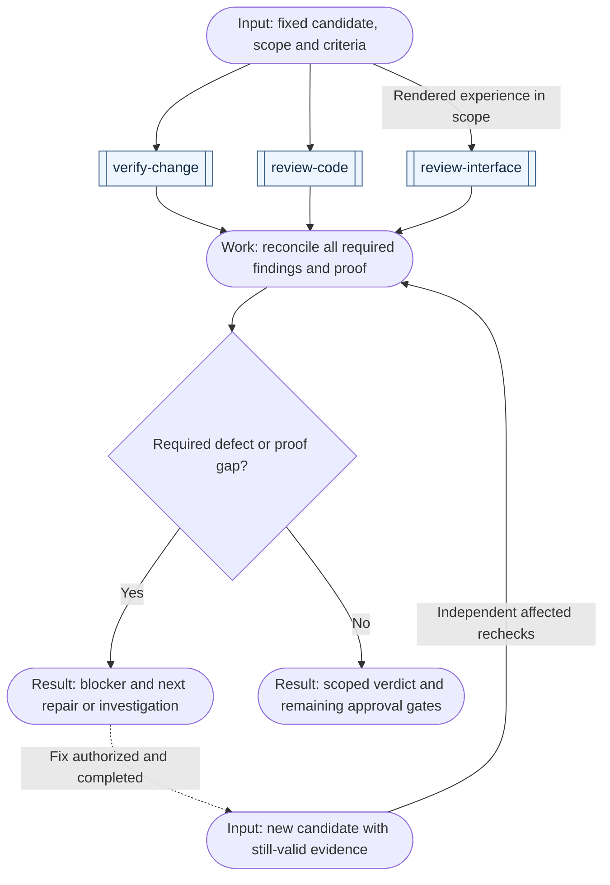

# Engineering workflows

[All workflows](../workflows.md) · [All engineering skills](../domains/engineering.md)

Start from an existing codebase, agreed change or observed failure. For the complete feature path, open the [idea-to-delivery preview](../../README.md#from-idea-to-delivery).

## Understand and prepare a project

| Example request | First skill | Result and conditional continuation |
| --- | --- | --- |
| "I inherited this app; establish how we can work on it safely." | [onboard-codebase](../../skills/engineering/onboard-codebase/SKILL.md) | A verified working baseline and preserved contracts; implement a ready first task or investigate a specific gap |
| "Explain how this feature works." | [explain-codebase](../../skills/engineering/explain-codebase/SKILL.md) | Located behavior and data flow; finish with the explanation, or use `review-code` for a separately requested assessment |
| "Recover our conventions and decisions from the code and history." | [document-project](../../skills/engineering/document-project/SKILL.md) | Evidence-backed records and useful indexes; unresolved rule choices go to `define-project-conventions` rather than becoming invented history |
| "Set folder structure, class/file boundaries and naming before we plan or code." | [define-project-conventions](../../skills/engineering/define-project-conventions/SKILL.md) | Scoped rules and exceptions carried into architecture/tasks; use `automate-code-checks` for suitable accepted enforcement or `create-tasks` for an agreed adoption change |
| "Make our existing project guidance easy for agents to find." | [prepare-repo-for-agents](../../skills/engineering/prepare-repo-for-agents/SKILL.md) | Working entry points to authoritative context and commands; missing factual records belong to `document-project` |
| "These docs overlap and disagree; consolidate them." | [consolidate-docs](../../skills/engineering/consolidate-docs/SKILL.md) | Reconciled content and repaired links; verify affected navigation without adding another summary document |
| "Hand this unfinished work to another session or owner." | [prepare-handoff](../../skills/productivity/prepare-handoff/SKILL.md) | Current state, authority, evidence and next runnable action; resume from checked state instead of repeating discovery |
| "Prepare this sprint's engineering update from our tracker and deployment evidence." | [report-project-status](../../skills/productivity/report-project-status/SKILL.md) | Verified progress, blockers and next decisions for the stated audience/period; sending requires its own authority, and an owner transfer uses `prepare-handoff` |
| "Our PR reviews keep waiting for the wrong person; improve that process." | [improve-team-workflow](../../skills/productivity/improve-team-workflow/SKILL.md) | Current/proposed steps and a bounded trial; accepted implementation can become tasks, while a planned trial cannot claim saved time |
| "Should we automate this recurring report with AI or use an existing feature?" | [improve-team-workflow](../../skills/productivity/improve-team-workflow/SKILL.md) | Compare credible options including review, exceptions and maintenance; a recommendation does not purchase or deploy a tool |

## Specify behavior and technical design

| Example request | First skill | Result and conditional continuation |
| --- | --- | --- |
| "Turn this agreed feature into a PRD or structured issue." | [write-spec](../../skills/engineering/write-spec/SKILL.md) | Scenarios and acceptance criteria; settle missing design, then use `plan-phases` for milestones or `create-tasks` for bounded work |
| "Clarify what an account, workspace and membership mean here." | [model-domain](../../skills/engineering/model-domain/SKILL.md) | Domain concepts, invariants and ownership; carry them into `write-spec` or `design-architecture` |
| "Choose the stack, boundaries and hosting for this app or AI capability." | [design-architecture](../../skills/engineering/design-architecture/SKILL.md) | Technical choices grounded in workload, data, cost and existing infrastructure; use `build-prototype` for unproven feasibility |
| "Plan a move to this accepted data/service architecture." | [plan-migration](../../skills/engineering/plan-migration/SKILL.md) | Compatibility, transfer, cutover and recovery plan; use phases/tasks to decompose authorized execution, with gates before live changes |

For journeys, screen structure and visual detail, continue in [UI/UX](ui-ux.md). Reconcile required technical and experience decisions before their dependent work.

## Plan and change software

| Example request | First skill | Result and conditional continuation |
| --- | --- | --- |
| "Which of these backlog items fit our next work period?" | [prioritize-work](../../skills/productivity/prioritize-work/SKILL.md) | Selection, order, deferrals and capacity/prerequisite limits; decompose selected scope with `create-tasks` or begin an accepted ready task when execution is authorized |
| "Break this agreed project into deliverable phases." | [plan-phases](../../skills/engineering/plan-phases/SKILL.md) | Milestones with prerequisites and exits; use `create-tasks` for the selected sufficiently understood phase |
| "Make executable tasks from this spec, with dependencies." | [create-tasks](../../skills/engineering/create-tasks/SKILL.md) | Owned tasks and checks, locally or in an authorized tracker; use `implement-change` only for a selected ready batch |
| "The stack and scope are agreed; bootstrap the new repository." | [start-project](../../skills/engineering/start-project/SKILL.md) | A checked foundation, blank or from an accepted template; implement the first agreed capability next |
| "Implement this ready feature, fix or selected refactor." | [implement-change](../../skills/engineering/implement-change/SKILL.md) | The scoped change and proof; obtain missing independent evaluation before authorized delivery |
| "This previously working action now fails; establish why." | [diagnose-issue](../../skills/engineering/diagnose-issue/SKILL.md) | Reproduction, tested cause and exact gaps; a selected repair goes to `implement-change`, while changed product behavior may need a spec |
| "Measure and reduce this feature's latency." | [improve-performance](../../skills/engineering/improve-performance/SKILL.md) | A profile and, when requested, a measured repair under comparable conditions; review/deliver only within scope |
| "Update these dependencies and adapt their consumers." | [upgrade-dependencies](../../skills/engineering/upgrade-dependencies/SKILL.md) | A compatible, verified change; review it and deliver when requested |
| "Find worthwhile refactors, duplication or bottlenecks in this code/data layer." | [find-improvements](../../skills/engineering/find-improvements/SKILL.md) | Ranked evidenced candidates; measure suspected performance issues or implement one selected refactor with preservation checks |
| "This accepted coding rule keeps being broken; automate its check." | [automate-code-checks](../../skills/engineering/automate-code-checks/SKILL.md) | A calibrated guard with invalid failures and valid passes; review the check and keep bulk remediation separately scoped |

A greenfield idea may start with exploration; an agreed greenfield foundation can start with `start-project`. A brownfield change preserves existing behavior and useful conventions, but a familiar bounded feature does not require whole-project onboarding. A small ready fix can skip spec, phase and task documents.

## Verify, review and deliver

| Example request | First skill | Result and conditional continuation |
| --- | --- | --- |
| "Prove this change meets these criteria, including before/after evidence." | [verify-change](../../skills/engineering/verify-change/SKILL.md) | Observed outcomes and exact gaps; diagnose unexplained failures, repair selected defects, or obtain a missing independent assessment |
| "Review this PR, feature or bounded codebase for defects." | [review-code](../../skills/engineering/review-code/SKILL.md) | Prioritized findings and inspected coverage; use `verify-change` for missing proof or implementation for authorized fixes |
| "Audit this rendered screen's usability and accessibility." | [review-interface](../../skills/ui-ux/review-interface/SKILL.md) | Observed interaction/visual findings and limits; route concrete fixes to implementation and unclear runtime failures to diagnosis |
| "Find out whether new users can finish this setup flow without assistance." | [test-usability](../../skills/ui-ux/test-usability/SKILL.md) | A focused study and findings from available participant observations, or a protocol with access gaps; use `map-user-flows` or `design-interface` for accepted changes and retest the relevant tasks |
| "Explain what this PR changes and why, using the available evidence." | [explain-pr](../../skills/engineering/explain-pr/SKILL.md) | A fixed-comparison explanation; finish if that is the request, reusing valid completed correctness reviews |
| "Take this reviewed change to the agreed PR, release or deployment target." | [ship-change](../../skills/engineering/ship-change/SKILL.md) | The authorized target and its observed checks; use `diagnose-issue` for a failure, `find-improvements` for a justified opportunity, or finish |
| "Prepare a GitHub release description from commits and merged PRs." | [ship-change](../../skills/engineering/ship-change/SKILL.md) | Notes checked against the chosen previous release and candidate; stop at notes, a remote draft, or publication according to the requested target |
| "Configure useful alerts for this service using our existing monitoring tools." | [configure-monitoring](../../skills/engineering/configure-monitoring/SKILL.md) | Scoped signals, owners and routes with observed checks; distinguish local tests from live delivery and use `ship-change` only for a requested delivery target |

For this collection's own release, use `ship-change` with the [release procedure](../authoring.md#releasing-the-collection), the exact reviewed commit and the intended channel. For example: "Prepare GitHub release notes for this collection at the selected commit. Read the relevant history and merged PRs, summarize supported skills and limitations, and include installation instructions. Return the notes and readiness gaps." A first release has no previous-release comparison; its notes describe the supported initial scope. Creating a remote draft, pushing a tag and publishing remain distinct requested targets.

If the request stops at a spec, explanation, design or review, return that result and the next useful action. Continue a broader workflow when it is already authorized. A small change may need no new planning document. `verify-change` also applies to changed docs or plans through scenario checks, consistency, links and rendered diagrams; it does not impose a code test suite on every artifact. Reuse valid proof, with independent evaluation, instead of duplicating a completed verification pass. Testing is required where relevant; test-first sequencing is not mandatory.

After delivery, inspect the requested health signals and actual target. Route a failure back to diagnosis or a justified opportunity to `find-improvements`. Use `configure-monitoring` when the requested result is missing or noisy monitoring coverage, carrying the target, existing signals and operating constraints. Configuration and live test notifications require their own scope and authority; a bounded check or verified setup does not promise a continuous watch. Carry useful decisions, learnings and incidents into existing project records.

## Review and recheck

Use `model-threats` when the missing result is a security model of the system or design: assets, trust boundaries, plausible abuse paths, existing protections and mitigation checks. Reuse architecture and local security conventions; a threat-modeling request does not authorize an active scan or implementation. Carry accepted mitigations into the existing requirements and task path.

When feedback already exists, `address-review-feedback` owns its resolution. Check each finding against current code and accepted requirements, preserve supported disagreements and stale/already-addressed dispositions, then implement authorized corrections and recheck them. Reviewing creates findings; addressing feedback resolves supplied findings.

Use the owning skill’s permitted depth. Simple routing, explanations, brainstorming and wording-only drafts can finish with direct checks where explicitly allowed. User/project requirements and consequential acceptance still require independent assessment; this exception does not waive code or delivery gates. The workflow below applies when review is required.

A large review can use stages without creating another project phase plan: establish scope and a fixed candidate, inspect distinct risks, reconcile findings across boundaries, then independently recheck authorized fixes. A small review can do this with one independent reviewer. Select extra review branches only for risks that need separate coverage.

This example reviews a code change with required behavioral proof and an optional rendered-interface assessment. Each double-bordered node is one skill; rounded nodes are coordination work, inputs or results. Reuse completed valid proof/reviews, and wait for every required branch before the verdict. Evidence capture and risk inspection can overlap on the same fixed candidate when their checks do not interfere. A browser session, shared test database, rate limit or mutable service can require separate fixtures or sequential checks even for read-only source reviewers. Reconcile cross-boundary behavior after the relevant branch results exist; a specialist's clean report covers only its inspected scope.

After a fix, identify which paths, criteria and artifacts changed, independently rerun affected checks, and reconcile against the updated candidate before issuing a new verdict. Keep unaffected evidence with its original tested revision and explain why it still applies. Missing required access or unresolved behavior remains a blocker; a review can finish by reporting that gap. Only the coordinator changes shared review/task records unless ownership is explicitly divided.

## Specs, tasks and PRs

A spec is the behavior contract; a phase is a deliverable milestone; a task is an owned unit of work; a PR is a review and integration boundary. They do not map one-to-one. One phase may need several PRs. Several small tasks may belong in one coherent PR. Split PRs by independently reviewable behavior, dependencies and safe integration, not merely by frontend/backend folders or task count.

Link a task's acceptance criteria to the relevant spec IDs and phase exits. A proposed PR group records included tasks, prerequisite PRs or contracts, preserved behavior, verification and recovery conditions. Follow the repository's branch/stack policy, and identify incomplete feature slices honestly. Do not invent a PR number or mark a milestone delivered because its first task merged.

At PR creation, describe the actual change and include observed checks, useful before/after evidence, independent findings and their disposition, plus remaining gaps. Use `explain-pr` when an explanation is the requested result, `review-code` for correctness and risk findings, and `ship-change` to reach an authorized delivery target. An intent question is not a correctness finding; an explanation is not approval to merge.
