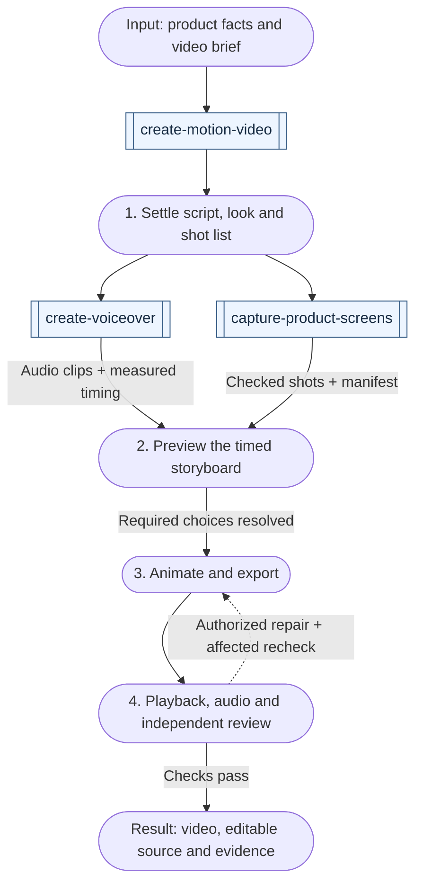

# Media workflows

[All workflows](../workflows.md) · [All media skills](../domains/media.md)

Choose the requested artifact below, or follow the [narrated-video example](#from-script-to-checked-video) to see how three skills work together. Double-bordered boxes name skills; rounded boxes show inputs, work or results; diamonds are decisions. Reuse completed stages and follow only the branches your result needs.

## Produce media

| Example request | First skill | Result and conditional continuation |
| --- | --- | --- |
| "Create a short animated explainer from these supported facts." | [create-motion-video](../../skills/media/create-motion-video/SKILL.md) | Resolve missing brief choices, preview script/look/storyboard, then render and check the authorized export; missing tools or playback leave explicit gaps |
| "Show the script and storyboard before animating anything." | [create-motion-video](../../skills/media/create-motion-video/SKILL.md) | A timed preview at requested fidelity; finish there without claiming an exported video |
| "Fix the clipped text in this existing motion composition and export vertical and landscape versions." | [create-motion-video](../../skills/media/create-motion-video/SKILL.md) | Reuse the source and accepted story, repair each layout, and recheck actual exports, joins and applicable audio |
| "Tighten this recorded demo and make a vertical captioned cut." | [edit-video](../../skills/media/edit-video/SKILL.md) | Trace source ranges into output time, preserve meaning and originals, then inspect the actual crop, captions and export |
| "Correct this one caption; keep the cut unchanged." | [edit-video](../../skills/media/edit-video/SKILL.md) | A scoped caption repair and affected checks; skip discovery and recutting when accepted context suffices |
| "Turn these accepted findings into a five-minute presentation using our template." | [create-presentation](../../skills/media/create-presentation/SKILL.md) | An editable deck and requested export, checked slide by slide; preserve source facts and distinguish talk notes from visible text |
| "Outline the deck first; do not build the slides yet." | [create-presentation](../../skills/media/create-presentation/SKILL.md) | A sourced slide sequence at requested fidelity; no claimed rendered deck or compatibility |
| "Turn this article into a social carousel with image exports and alt text." | [create-carousel](../../skills/media/create-carousel/SKILL.md) | A self-contained ordered panel sequence, editable source and checked exports; reuse the article without restarting editorial work |
| "Repair the clipped text on panel three; leave the other panels alone." | [create-carousel](../../skills/media/create-carousel/SKILL.md) | A scoped layout repair with evidence at reading size and checked sequence; no unsolicited full redesign |
| "Make a 45-second narrated explainer for our app." | [create-motion-video](../../skills/media/create-motion-video/SKILL.md) | A brief with playback mode and a short narration-led script; narration from `create-voiceover` and real screens from `capture-product-screens` when needed, with beats timed to the measured manifest |
| "Generate the voice-over for this accepted script with ElevenLabs." | [create-voiceover](../../skills/media/create-voiceover/SKILL.md) | Authorized provider use with current voice and model IDs, checked name pronunciation, one clip per line, a stem and a timing manifest; unheard lines stay open |
| "Capture marketing screenshots of our dashboard for the landing page." | [capture-product-screens](../../skills/media/capture-product-screens/SKILL.md) | Seeded, deterministic captures of the screens the copy names, a shot manifest, whole-frame checks for forbidden content and a missing-asset guard |

## From script to checked video

Example: a narrated product explainer using real app screens. `create-motion-video` owns the production; the other two skills supply assets. This example needs both narration and captures. Reuse either when its existing files and checks still match the brief. A silent animation or footage-only edit follows its own artifact owner above.

The join waits for both asset sets; estimated narration length cannot substitute for measured timing. Script changes can invalidate narration and the storyboard; recaptures can invalidate pixel-dependent animation. Return to the affected owner before continuing. If a required check fails, repair the affected source and repeat its checks; missing access or an unresolved choice leaves a blocker. A storyboard-only request stops after its preview and scoped assessment. Delivery of a file does not authorize publishing it.

A narrated product explainer often draws on `capture-product-screens` and `create-voiceover` before animation. Both can run in parallel once the script and shot list are accepted; motion timing waits for the measured narration manifest, and a recapture rechecks shots that consumers use by pixel position.

Independent scenes, slides or panels may overlap only after shared story, visual rules, assets and join/ordering contracts are settled, with isolated ownership and one integration owner. Final assembly and assessment wait for all required parts. Recheck affected formats after changes; a new recording or cut invalidates dependent timing and captions.

Inspect every final slide/panel, and check video joins, normal-speed playback and applicable audio. Contact sheets prove only inspected stills. Keep output format, editability, accessibility and tool limitations explicit. Human choices and independent evaluation remain separate; producing an artifact does not authorize upload or publication. Mixed productions pass a checked artifact to the next owner only when that additional result is requested.
