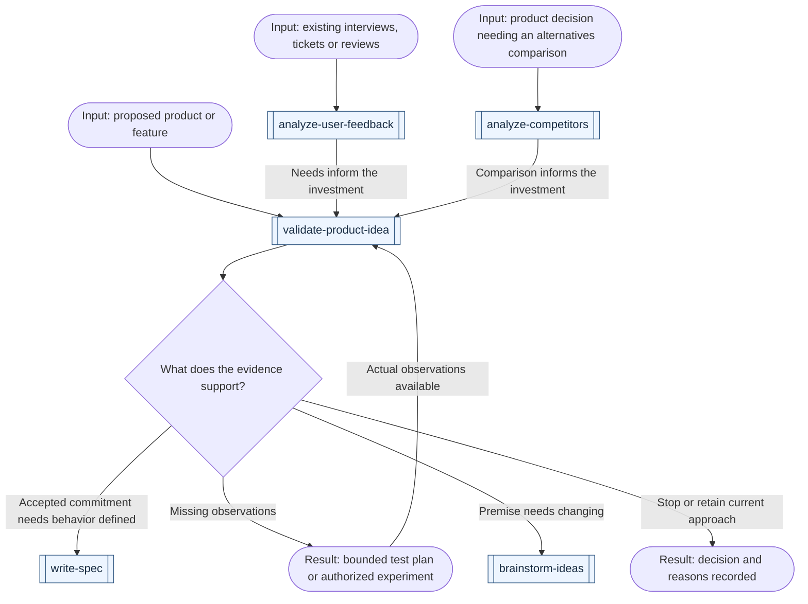
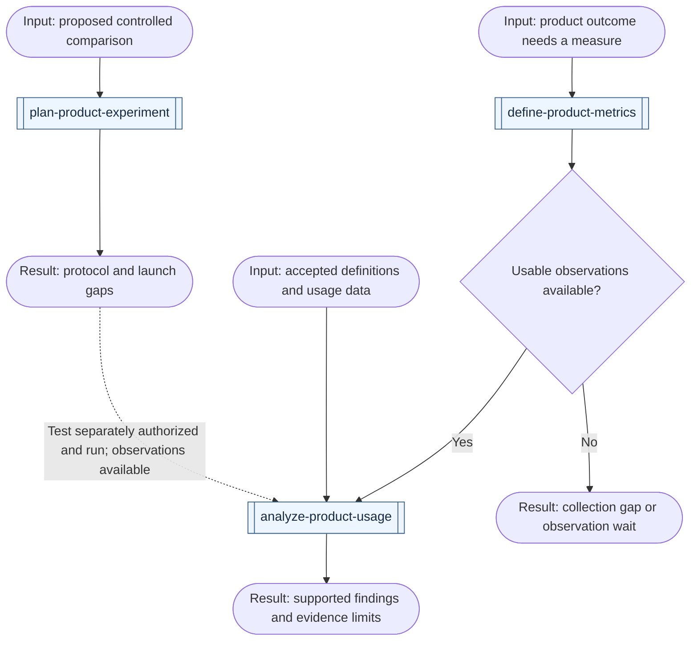

# Product workflows

[All workflows](../workflows.md) · [All product skills](../domains/product.md)

Start with the decision you need to make: whether to invest, how to measure success, or what existing observations support. Double-bordered boxes name skills; rounded boxes show inputs, work or results; diamonds are decisions. Reuse completed stages and follow only the branches your result needs.

## Evaluate a product opportunity

| Example request | First skill | Result and conditional continuation |
| --- | --- | --- |
| "Should we invest in this new product idea, given these interviews and constraints?" | [validate-product-idea](../../skills/product/validate-product-idea/SKILL.md) | An evidence-backed next decision or bounded test plan; use `write-spec` for accepted scope, without claiming an unexecuted test validated demand |
| "Should we add this feature to the existing product?" | [validate-product-idea](../../skills/product/validate-product-idea/SKILL.md) | Assess the target segment, observed need, alternatives and commitment while preserving working behavior; skip rediscovery for an already accepted change |
| "What needs are supported by these interviews, tickets and reviews?" | [analyze-user-feedback](../../skills/product/analyze-user-feedback/SKILL.md) | Deduplicated needs with sources, opposing evidence and coverage limits; use validation for uncertain demand or prioritization when work candidates and capacity exist |
| "Compare competitors and manual alternatives for this product decision." | [analyze-competitors](../../skills/product/analyze-competitors/SKILL.md) | A dated, comparable assessment and supported implications; a proposed opportunity still needs user evidence before treating it as demand |

This graph shows possible handoffs. Start with the missing result and reuse existing evidence. A direct request for feedback synthesis or a comparison can finish at that result.

Feedback synthesis and competitor research can run in parallel after the audience, job and decision are agreed, when their sources and workspaces allow independent work. Reconcile shared assumptions before a decision depending on both; neither branch is mandatory. Independent review challenges the actual sources and conclusions before acceptance. It cannot stand in for user observations, and a proposed test does not authorize recruitment, publication or spending.

## Measure product outcomes

| Example request | First skill | Result and conditional continuation |
| --- | --- | --- |
| "Define how we will know this new product or feature helps users." | [define-product-metrics](../../skills/product/define-product-metrics/SKILL.md) | A measurement contract grounded in the outcome; implement agreed missing instrumentation separately, with no invented baseline |
| "Our dashboards disagree about activation; settle the definition." | [define-product-metrics](../../skills/product/define-product-metrics/SKILL.md) | Reconciled semantics and versioned definitions; preserve historical comparability and name data-quality checks |
| "Plan an A/B test for this change before exposing users." | [plan-product-experiment](../../skills/product/plan-product-experiment/SKILL.md) | A protocol with assignment, measures, sample feasibility, stopping and decision rules; missing inputs remain launch gaps |
| "Read this experiment result; can we trust the apparent winner?" | [analyze-product-usage](../../skills/product/analyze-product-usage/SKILL.md) | Check protocol, assignment, sample quality, maturity and harm outcomes before interpreting effects; analysis does not authorize rollout |
| "Did adoption or retention change in the observed cohorts?" | [analyze-product-usage](../../skills/product/analyze-product-usage/SKILL.md) | Findings from checked definitions and eligible observation windows; separate association, measurement changes and unproven explanations |
| "Analyze this new product, but there are no usage observations yet." | [analyze-product-usage](../../skills/product/analyze-product-usage/SKILL.md) | A bounded analysis plan and exact data gaps; missing outcomes cannot become zero usage or a validated conclusion |

These arrows show possible handoffs. Existing definitions and observations can enter analysis directly.

Experiment planning reuses accepted measures and checks whether the proposed comparison is feasible. Low traffic, missing power inputs or shared-user effects may prevent a useful A/B test; a weaker alternative must keep its evidence limits. Launch and implementation remain separately scoped.

An accepted collection gap can go to `implement-change`; a required observation window must actually elapse before its outcome is available. Analysis can run alongside feedback synthesis on independent evidence, but any shared product decision waits for the relevant findings and their independent reviews. Technical alerts remain with `configure-monitoring`; a product metric does not imply a service incident or an ongoing monitoring commitment.
