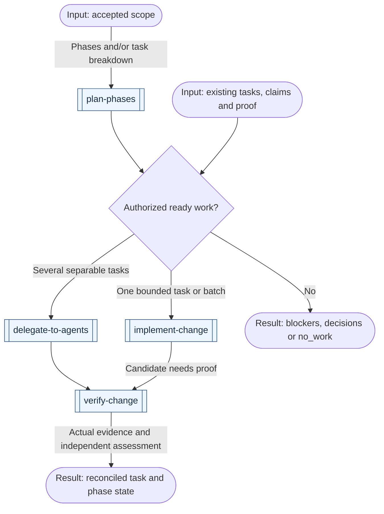

# Productivity workflows

[All workflows](../workflows.md) · [All productivity skills](../domains/productivity.md)

Choose the next useful action, resolve missing decisions or coordinate already-agreed work. Execution and parallelism depend on the [shared coordination rules](coordination.md). Double-bordered boxes name skills; rounded boxes show inputs, work or results; diamonds are decisions. Reuse completed stages and follow only the branches your result needs.

## Explore and route

| Example request | First skill | Result and conditional continuation |
| --- | --- | --- |
| "I know the goal, but which skill fits the next step?" | [choose-skill](../../skills/productivity/choose-skill/SKILL.md) | A next action from the current state; invoke it only when the request includes execution |
| "I have an idea for a new product; help me compare approaches." | [brainstorm-ideas](../../skills/productivity/brainstorm-ideas/SKILL.md) | Options and trade-offs; use `challenge-proposal` for unresolved choices or `write-spec` once the direction is supported |
| "Question this proposal before we commit to it." | [challenge-proposal](../../skills/productivity/challenge-proposal/SKILL.md) | Consequential answers and exposed assumptions; research unsupported premises before relying on them |
| "Is this service suitable under these constraints?" | [research-topic](../../skills/productivity/research-topic/SKILL.md) | A sourced answer; use `design-architecture` when the next output is an accepted technical choice |
| "Can this approach handle our workload? Test the uncertain part." | [build-prototype](../../skills/engineering/build-prototype/SKILL.md) | A bounded experiment and observations; revise the relevant decision/spec before production implementation |
| "Make this agent instruction clearer without running it." | [improve-prompt](../../skills/productivity/improve-prompt/SKILL.md) | A checked rewrite preserving intent; finish with the prompt unless an evaluation or execution was requested |
| "Split these ready tasks across agents while I keep coordinating." | [delegate-to-agents](../../skills/productivity/delegate-to-agents/SKILL.md) | Safe briefs and returned/integrated results at the requested stopping point; missing host support remains an explicit gap |
| "Mine our commits and agent sessions for repeated mistakes and create useful project-specific skills." | [create-project-skill](../../skills/productivity/create-project-skill/SKILL.md) | Corroborate and deduplicate episodes, recommend mechanical checks, create and trial justified local skills; use `automate-code-checks` for a selected guard |
| "Check whether this skill change actually improves results." | [evaluate-skill](../../skills/productivity/evaluate-skill/SKILL.md) | Compare fixed variants on realistic cases and actual traces; keep wording-only edits with `improve-prompt` |
| "This ticket may be a duplicate or a support question; work out what it needs." | [assess-request](../../skills/engineering/assess-request/SKILL.md) | Evidence, impact and a route; choose `diagnose-issue` for a failure, `write-spec` for missing behavior, or a support/closure recommendation |

## Where clarification happens

Every skill resolves missing input for its own outcome. Use `challenge-proposal` to examine a proposal with the user: inspect what can be discovered, ask the highest-impact unresolved question, follow the answer, and update the existing proposal. Ask about actors, boundaries, failures, recovery and preservation only where their answers could change the result. Explain the trade-off and let the human make choices that belong to them. Do not ask a fixed questionnaire or reopen accepted answers.

A clarified proposal is not a validated concept: demand, feasibility, and performance assumptions need relevant evidence. Use research for missing facts or evidence behind a product commitment, or a bounded prototype for empirical feasibility. An unanswered consequential choice blocks only the work that depends on it; unrelated investigation can continue. Stop questioning when the requested result is sufficiently clear, and carry accepted answers into the spec, phases and tasks.

## Coordinate local project work

For a "software factory" using agents, start from the missing contract below. The phase/task flow connects accepted scope to bounded execution, independent evaluation and delivery. Reuse the project's tracker and workers; Markdown instructions do not create a scheduler or establish safe parallelism.

| Example request | First skill | Result and conditional continuation |
| --- | --- | --- |
| "Break this accepted scope into tasks agents can pick up." | [plan-phases](../../skills/engineering/plan-phases/SKILL.md) | Owned tasks with acceptance checks and dependencies; keep ongoing state in the project's existing tracker |
| "Use agents to work through these ready tasks while I keep coordinating." | [delegate-to-agents](../../skills/productivity/delegate-to-agents/SKILL.md) | Bounded briefs, isolated work and checked integration; verify and independently review before closing tasks or delivering |
| "Transfer this unfinished work to another owner or session." | [prepare-handoff](../../skills/productivity/prepare-handoff/SKILL.md) | Accepted context, current state, evidence, authority and the next runnable action; no repeated discovery or assumed operation success |

Arrows below are possible handoffs. Start with existing accepted contracts when they suffice. The host supplies any workers and isolation.

One coordinator writes shared state. Workers receive bounded contracts and return evidence; another session independently checks acceptance. Important blocked work remains blocked, and a ready queue never authorizes draining the backlog. If multiple coordinators must claim concurrently, use a tracker with actual concurrency controls.

## Hand off and evaluate work

| Request | Owner | Result and boundary |
| --- | --- | --- |
| Split a bounded task across workers | [delegate-to-agents](../../skills/productivity/delegate-to-agents/SKILL.md) | Coordinate self-contained parts and verify joined results without assuming a particular checkout or model policy. |
| Transfer a run paused on a human step | [prepare-handoff](../../skills/productivity/prepare-handoff/SKILL.md) | Preserve the safe checkpoint, last verified platform state and existing authority; the recipient checks state before continuing or retrying. |
| Grade supplied trial outputs or a candidate/baseline comparison | [evaluate-skill](../../skills/productivity/evaluate-skill/SKILL.md) | Separate structural validity, semantic outcomes and actual authority/trace evidence. A model judge needs explicit calibration limits. |

Observed accepted inputs determine execution. Running a named workflow definition is host or project work outside this collection; neither a pending operation nor an unavailable engine authorizes inventing another workflow.
