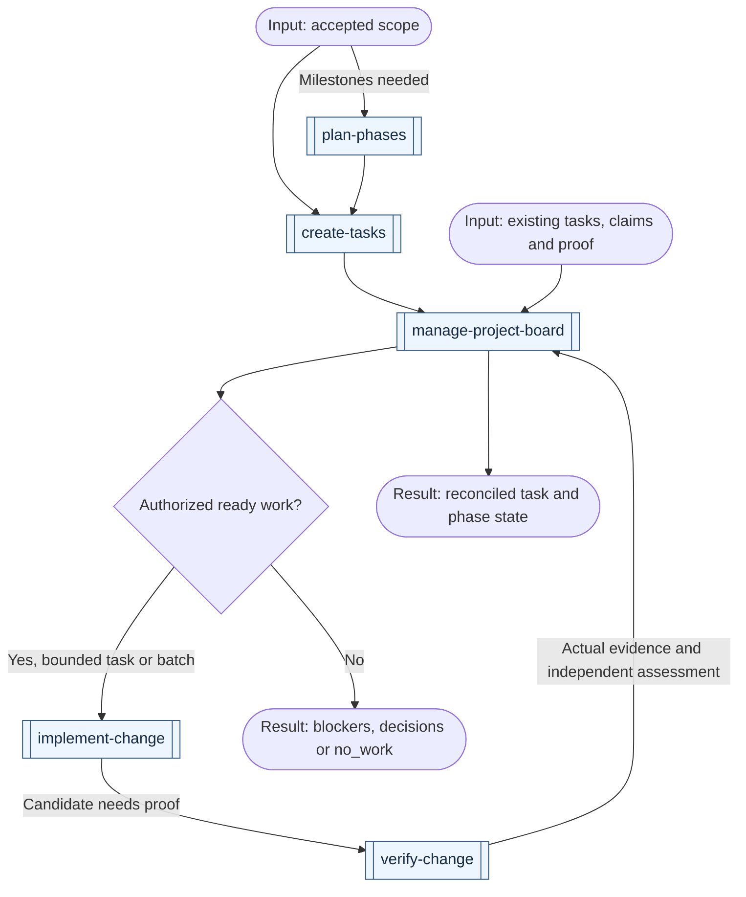

# Productivity workflows

[All workflows](../workflows.md) · [All productivity skills](../domains/productivity.md)

Choose the next useful action, resolve missing decisions or coordinate already-agreed work. Execution and parallelism depend on the [shared coordination rules](coordination.md). Double-bordered boxes name skills; rounded boxes show inputs, work or results; diamonds are decisions. Reuse completed stages and follow only the branches your result needs.

## Explore and route

| Example request | First skill | Result and conditional continuation |
| --- | --- | --- |
| "I know the goal, but which skill fits the next step?" | [choose-skill](../../skills/productivity/choose-skill/SKILL.md) | A next action from the current state; invoke it only when the request includes execution |
| "I have an idea for a new product; help me compare approaches." | [brainstorm-ideas](../../skills/productivity/brainstorm-ideas/SKILL.md) | Options and trade-offs; use `challenge-proposal` for unresolved choices or `write-spec` once the direction is supported |
| "Question this proposal before we commit to it." | [challenge-proposal](../../skills/productivity/challenge-proposal/SKILL.md) | Consequential answers and exposed assumptions; research unsupported premises before relying on them |
| "Is this service suitable under these constraints?" | [research-topic](../../skills/productivity/research-topic/SKILL.md) | A sourced answer; use `design-architecture` when the next output is an accepted technical choice |
| "Can this approach handle our workload? Test the uncertain part." | [build-prototype](../../skills/engineering/build-prototype/SKILL.md) | A bounded experiment and observations; revise the relevant decision/spec before production implementation |
| "We keep losing track of unresolved decisions and what they block." | [track-project-decisions](../../skills/productivity/track-project-decisions/SKILL.md) | Current choices, dependencies and next ready question; specify settled portions without waiting for the whole initiative |
| "Make this agent instruction clearer without running it." | [improve-prompt](../../skills/productivity/improve-prompt/SKILL.md) | A checked rewrite preserving intent; finish with the prompt unless an evaluation or execution was requested |
| "Check whether this skill change actually improves results." | [evaluate-skill](../../skills/productivity/evaluate-skill/SKILL.md) | Compare fixed variants on realistic cases and actual traces; keep wording-only edits with `improve-prompt` |
| "This ticket may be a duplicate or a support question; work out what it needs." | [assess-request](../../skills/engineering/assess-request/SKILL.md) | Evidence, impact and a route; choose `diagnose-issue` for a failure, `write-spec` for missing behavior, or a support/closure recommendation |

## Where clarification happens

Every skill resolves missing input for its own outcome. Use `challenge-proposal` to examine a proposal with the user: inspect what can be discovered, ask the highest-impact unresolved question, follow the answer, and update the existing proposal. Ask about actors, boundaries, failures, recovery and preservation only where their answers could change the result. Explain the trade-off and let the human make choices that belong to them. Do not ask a fixed questionnaire or reopen accepted answers.

A clarified proposal is not a validated concept: demand, feasibility, and performance assumptions need relevant evidence. Use `validate-product-idea` for a product commitment, research for missing facts, or a bounded prototype for empirical feasibility. An unanswered consequential choice blocks only the work that depends on it; unrelated investigation can continue. Stop questioning when the requested result is sufficiently clear, and carry accepted answers into the spec, phases and tasks.

## Coordinate local project work

For a "software factory" using agents, start from the missing contract below. The existing phase/task/board flow already connects accepted scope to bounded execution, independent evaluation and delivery. Reuse the project's tracker and workers; Markdown instructions do not create a scheduler or establish safe parallelism.

| Example request | First skill | Result and conditional continuation |
| --- | --- | --- |
| "Keep our accepted plan and tasks in a local Markdown project board." | [manage-project-board](../../skills/productivity/manage-project-board/SKILL.md) | Use the existing docs location or a small board at `docs/project/README.md`; link accepted plans and keep each task authoritative in one place |
| "Which task can an agent pick up next, and what is blocked?" | [manage-project-board](../../skills/productivity/manage-project-board/SKILL.md) | Checked readiness, ownership and human decisions; select one task or agreed ready batch, with execution only within granted scope |
| "This phase looks done because its PRs merged; reconcile the board." | [manage-project-board](../../skills/productivity/manage-project-board/SKILL.md) | Inspect task proof, integration and the phase's actual exit; preserve unverified deployment or acceptance as a gap |
| "Use agents to work through our accepted backlog as a software factory." | [manage-project-board](../../skills/productivity/manage-project-board/SKILL.md) | Reconcile readiness and assign a bounded task or batch within authority; isolate work, integrate, verify and independently review before closing tasks or delivering |

Arrows below are possible handoffs. Start with existing accepted contracts when they suffice. Board files describe coordination; the host supplies any workers and isolation.

One coordinator writes shared state. Workers receive bounded contracts and return evidence; another session independently checks acceptance. Important blocked work remains blocked, and a ready queue never authorizes draining the backlog. If multiple coordinators must claim concurrently, use a tracker with actual concurrency controls. A Scrum-style view is optional; preserve the team's state meanings, capacity and cycle goal. See the skill's board template for defaults and file placement.
