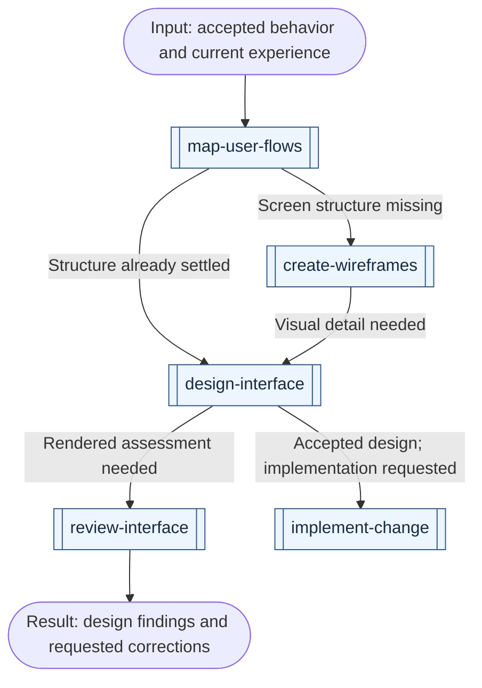

# UI/UX workflows

[All workflows](../workflows.md) · [All UI/UX skills](../domains/ui-ux.md)

Start from accepted behavior and the next missing design result. For a website whose message and layout both need work, use the [product-page route](content.md#plan-and-write-a-product-page).

## Specify and design

Reuse existing accepted outputs and enter at the next missing result. Technical architecture belongs to [engineering](engineering.md#specify-behavior-and-technical-design); a website can also need the [content route](content.md#plan-and-write-a-product-page).

Arrows are conditional handoffs, not a required sequence. A bounded flow, wireframe or design request can finish with its own checks. Reconcile any required review findings before accepting the design or handing it to implementation. A rendered audit does not replace participant observations from `test-usability`.

| Example request | First skill | Result and conditional continuation |
| --- | --- | --- |
| "Map how a user completes this task, including errors and recovery." | [map-user-flows](../../skills/ui-ux/map-user-flows/SKILL.md) | Actors, states and transitions; use `create-wireframes` for unresolved screen structure, or `design-interface` for visual detail when structure is settled |
| "People cannot find the right settings; reorganize the navigation." | [map-user-flows](../../skills/ui-ux/map-user-flows/SKILL.md) | Destination inventory, hierarchy, labels and supported paths; use `test-usability` for participant findability evidence or `design-interface` for accepted composition work |
| "The journey is settled; sketch the new screen's structure and states." | [create-wireframes](../../skills/ui-ux/create-wireframes/SKILL.md) | Editable low-fidelity frames with hierarchy and state annotations; carry accepted structure into `design-interface` when visual detail is needed |
| "This existing screen is cluttered; propose a clearer structure while preserving its behavior." | [create-wireframes](../../skills/ui-ux/create-wireframes/SKILL.md) | Inspected current patterns and proposed structural changes; unresolved journey rules return to `map-user-flows`, and accepted layouts can continue to detailed design |
| "The screen structure is settled; design its visual detail and states." | [design-interface](../../skills/ui-ux/design-interface/SKILL.md) | A design or requested rendered result; use `implement-change` for a design handoff or `review-interface` for a missing rendered assessment |
| "Write validation, empty-state and permission messages without changing the layout." | [write-interface-copy](../../skills/ui-ux/write-interface-copy/SKILL.md) | Strings tied to actual states, terminology and recovery actions; use implementation for authorized wiring and verify the rendered result before claiming fit |
| "Capture these two interfaces as useful references for our dashboard." | [capture-design-reference](../../skills/ui-ux/capture-design-reference/SKILL.md) | Inspected patterns with capture conditions and evidence; use `design-interface` to adapt suitable ideas to the target product |
| "Several screens need consistent shared tokens and components." | [build-design-system](../../skills/ui-ux/build-design-system/SKILL.md) | Shared contracts demonstrated in real consumers; carry them into `design-interface` or implementation |

Architecture and UI design answer different questions. `design-architecture` owns technical structure; `map-user-flows` owns the journey; `create-wireframes` owns low-fidelity screen structure; `design-interface` owns visual detail and complete interface states; `build-design-system` owns repeated shared interface needs. `build-prototype` tests a consequential uncertainty with an experiment. Use only the missing results and reconcile shared contracts; accepted flows or existing screens can start wireframing directly, and settled structure can skip it. UI and technical design may overlap once shared behavior is settled and their work is isolated; dependent implementation waits for accepted inputs.
