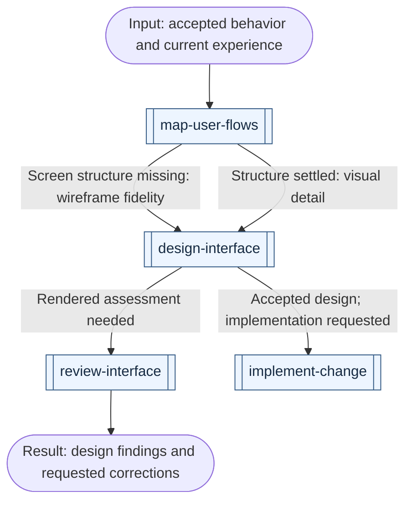

# UI/UX workflows

[All workflows](../workflows.md) · [All UI/UX skills](../domains/ui-ux.md)

Start from accepted behavior and the next missing design result. Website messaging and page prose are outside this collection; reconcile accepted copy with the layout.

## Specify and design

Reuse existing accepted outputs and enter at the next missing result. Technical architecture belongs to [engineering](engineering.md#specify-behavior-and-technical-design).

Arrows are conditional handoffs, not a required sequence. A bounded flow, wireframe or design request can finish with its own checks. Reconcile any required review findings before accepting the design or handing it to implementation. A rendered audit does not replace participant observations from a usability study.

| Example request | First skill | Result and conditional continuation |
| --- | --- | --- |
| "Map how a user completes this task, including errors and recovery." | [map-user-flows](../../skills/ui-ux/map-user-flows/SKILL.md) | Actors, states and transitions; use `design-interface` at wireframe fidelity for unresolved screen structure, or for visual detail when structure is settled |
| "People cannot find the right settings; reorganize the navigation." | [map-user-flows](../../skills/ui-ux/map-user-flows/SKILL.md) | Destination inventory, hierarchy, labels and supported paths; prepare a bounded study for participant findability evidence, or use `design-interface` for accepted composition work |
| "The journey is settled; sketch the new screen's structure and states." | [design-interface](../../skills/ui-ux/design-interface/SKILL.md) | At wireframe fidelity, editable low-fidelity frames with hierarchy and state annotations; continue to visual detail when requested |
| "This existing screen is cluttered; propose a clearer structure while preserving its behavior." | [design-interface](../../skills/ui-ux/design-interface/SKILL.md) | Inspected current patterns and proposed structural changes; unresolved journey rules return to `map-user-flows`, and accepted layouts can continue to detailed design |
| "The screen structure is settled; design its visual detail, states and messages." | [design-interface](../../skills/ui-ux/design-interface/SKILL.md) | A design or requested rendered result; use `implement-change` for a design handoff or `review-interface` for a missing rendered assessment |
| "Review this rendered interface against its supported journeys." | [review-interface](../../skills/ui-ux/review-interface/SKILL.md) | Observed interaction, accessibility and visual findings with exact coverage; a rendered expert assessment cannot establish participant behavior |

Architecture and UI design answer different questions. `design-architecture` owns technical structure; `map-user-flows` owns the journey; `design-interface` owns low-fidelity screen structure at wireframe fidelity, visual detail, complete interface states and their messages. `build-prototype` tests a consequential uncertainty with an experiment. Use only the missing results and reconcile shared contracts; accepted flows or existing screens can start wireframing directly, and settled structure can skip it. UI and technical design may overlap once shared behavior is settled and their work is isolated; dependent implementation waits for accepted inputs.
