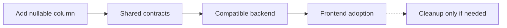
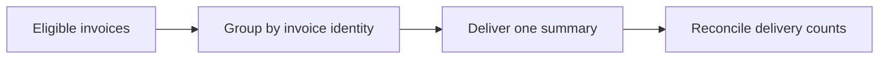
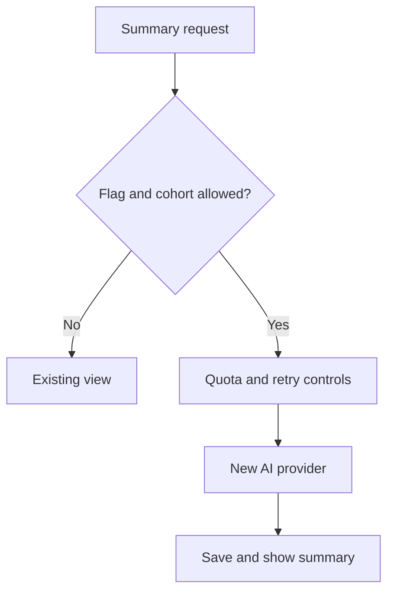
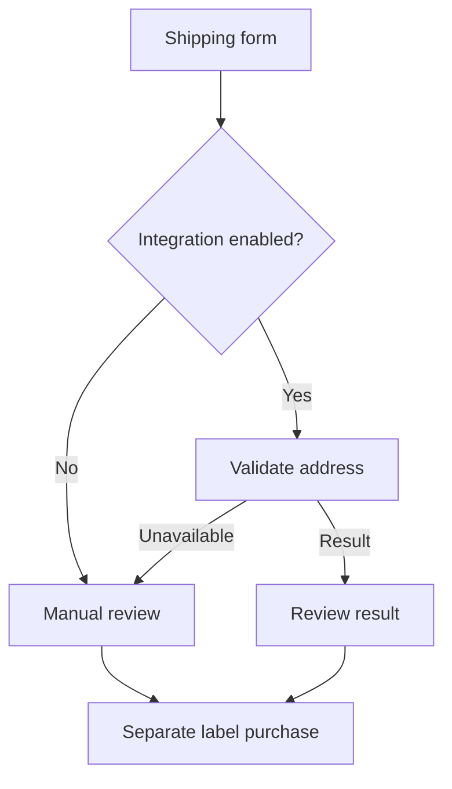
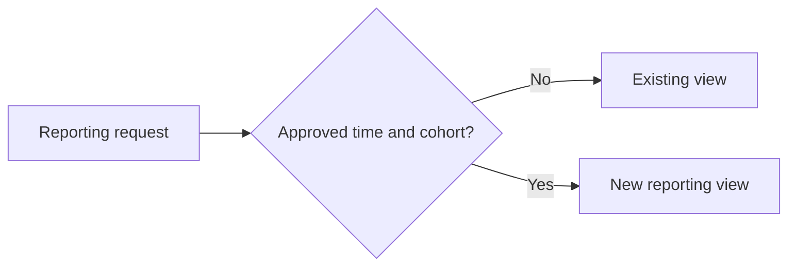

# Worked PR descriptions

Read only the scenario relevant to the change. The [default template](pr-description.template.md) owns the fields; these examples illustrate concise content, not additional rules. **All systems, numbers, dates and check results below are fictional.** Replace them with actual observations; never publish these results as your verification or invent an attachment. Diagrams explain the change; they do not prove execution.

## Documentation only

````markdown
## Summary

Correct the README spelling of “response”.

## Changes

```diff
- reponse
+ response
```
No command, link or behavior changes.

## Evidence and testing

Reviewed the one-word diff; **`git diff --check` passed**. No runtime or visual claim.

## Merge prerequisites

Normal repository checks/review; **no additional dependencies**.

## Rollout and monitoring

Readers receive the correction after merge; **no separate deployment or operating watch**.

## Risk and recovery

No operational or data risk identified. A source revert restores the previous text.
````

## UI-only change

````markdown
## Summary

Keep the settings Save action visible on narrow screens.

## Changes

- **Before:** the action overflows below the form at **390 px**.
- **After:** it wraps within the existing footer; submission and permissions stay unchanged.

```text
Settings form
└── Footer: wraps at narrow widths
    ├── Cancel
    └── Save: visible and keyboard reachable
```

## Evidence and testing

- **Passed:** component and keyboard checks.
- **Pending:** same-fixture desktop/mobile before-and-after captures; visual acceptance remains open. No backend change.

## Merge prerequisites

Required CI/review and the **missing visual/reflow comparison** must complete.

## Rollout and monitoring

Use the normal frontend release. The **release owner** checks Save visibility and keyboard focus on supported widths within **30 minutes of deployment**, then records that checkpoint; no persistent scheduled effect.

## Risk and recovery

Incorrect wrapping could obscure another action. Detect through the same viewport checks; revert the layout change if needed. **This does not undo submitted saves.**
````

## Compatible database migration

````markdown
## Summary

Add an optional booking note without breaking existing readers or writers.

## Changes

- Add a **nullable column**; existing values are unchanged.
- Shared contracts, backend and frontend consumers follow in dependent PRs. Old-field removal is outside this PR.



## Evidence and testing

- **Passed:** migration and old/new reader-writer checks on a representative staging fixture.
- **Unverified:** production lock duration and recovery rehearsal.

## Merge prerequisites

Required CI/review and an accepted migration window. Consumers must use the additive contract; **destructive cleanup stays blocked until consumers migrate**.

## Rollout and monitoring

Apply the migration **before dependent services**. The **database operator** checks lock waits, connection pressure, query latency and errors during the window and first real workload; stop if agreed service limits are exceeded.

## Risk and recovery

- Lock contention could affect the booking table. Old application code can run with the unused column left in place.
- **Dropping the column deletes newly stored notes.** A destructive down migration is not data recovery.
````

## Overnight job

````markdown
## Summary

Correct duplicate entries in the nightly invoice-summary job.

## Changes

- Group by the existing invoice identity before delivery.
- **Estimated reach: 1,200 eligible accounts**, assuming tenant/date filters match the current snapshot; confirm that population before exposure.



## Evidence and testing

- **Passed:** duplicate and cross-tenant fixture checks.
- **Pending:** the first affected production run; delivery and resource impact remain unverified.

## Merge prerequisites

Required CI/review, **confirmed population**, working job signals and an **assigned operator**. No unrelated schema change.

## Rollout and monitoring

- First effect: next **02:00 Europe/Ljubljana** run. The operator checks completion by **03:00** and reconciles counts by **08:00**.
- Compare failures, duplicate deliveries, queue age, CPU/memory and provider-call volume with the previous comparable run. A quiet hour after midday deployment does not verify this job.

## Risk and recovery

- Bad grouping could affect the estimated cohort or increase memory and paid delivery calls. **Missing completion, mismatched counts or breached resource limits stop further runs.**
- Correct and replay only unsent work through the existing runbook. **Sent messages cannot be recalled; recovery is not rehearsed.**
````

## New AI provider behind a feature flag

````markdown
## Summary

Introduce optional AI summaries for a **50-account pilot**.

## Changes

- Gate requests behind the existing **server-side feature flag**, default **off**, and approved cohort.
- Estimate **500–1,000 requests/day**; actual token distribution and production unit cost remain **unknown**. Retries can add billable calls.



## Evidence and testing

- **Passed with a fake provider:** authorization, duplicate-request and bounded-retry checks.
- **Unverified:** production quality, live cost and cancellation. Fake-provider checks do not establish the bill.

## Merge prerequisites

- **Before merge:** required CI/review and proof the pilot stays disabled by default.
- **Before exposure:** owner acceptance of provider/data handling, server-side credentials, spend basis, enforced limits and monitoring access. **A budget alert does not cap spending.**

## Rollout and monitoring

- Enable the flag only after those gates. The **operating owner** checks request/token counts, retries, latency, serverless duration/concurrency and errors for the **first hour** and after the **first 100 requests**.
- Check charges at the next provider refresh. Assumed billing delay: **24 hours**; confirm the actual delay and accepted budget/thresholds.

## Risk and recovery

- Retries or abuse could raise API, serverless, logging or egress charges. **Disable the flag and apply quotas** when limits are exceeded; verify whether in-flight calls can be cancelled.
- Output and data handling remain risks outside fake-provider checks. **A revert cannot refund charges, retract transmitted data or remove saved summaries.** Real spend remains open.
````

## New third-party API integration

````markdown
## Summary

Add optional address validation before label purchase, **initially disabled**.

## Changes

- Put the new provider behind the existing **server-side integration flag**; retain manual review when validation is unavailable.
- Keep credentials on the server; transmit only the required address fields.



## Evidence and testing

- **Passed in sandbox:** valid/invalid addresses, timeouts and rate-limit responses; no label purchases in these checks.
- **Unverified:** live credentials, provider limits, production latency, charges and retention terms.

## Merge prerequisites

- **Before merge:** required CI/review and proof default-off preserves the existing purchase path.
- **Before exposure:** accept provider/data terms, verify credentials and retry/rate/concurrency limits, and assign an operator with signal access. Confirm exhausted quota leaves manual review available.

## Rollout and monitoring

- Enable for the approved **20-account cohort**. Estimate **200 validations/day**, assuming one validation per address; confirm pricing and retry amplification before exposure.
- The **integration owner** compares errors, rate limits, latency and call counts with the existing flow for the **first hour** and **first 100 validations**. Check charges at the confirmed billing refresh; stop new calls if agreed limits or privacy conditions fail.

## Risk and recovery

- Provider outage, incorrect results or exhausted quota could delay shipping; retries could raise the bill. Keep validation separate from purchases; **verify the fallback before exposure**.
- **Disable the integration flag** and verify manual review. Sent addresses and incurred charges cannot be recalled by a code revert; provider deletion and in-flight cancellation depend on verified capabilities.
````

## Date- or flag-triggered activation

````markdown
## Summary

Prepare the reporting view for an agreed launch date without early exposure.

## Changes

- Existing **server-side gating** keeps the view off until approved activation.
- Expected reach: **60-account cohort**, conditional on reviewed flag rules. The frontend toggle alone does not establish that boundary.



## Evidence and testing

- **Passed with a controlled clock:** before/after-boundary and unauthorized-cohort checks.
- **Pending:** real activation and post-launch behavior.

## Merge prerequisites

Required CI/review, accepted cohort/timezone, verified backend compatibility and an activation operator. **Merge does not authorize enabling the flag.**

## Rollout and monitoring

Record the **exact activation date/time/timezone** in the release plan. The **operator** checks the actual cohort at activation and after the **first representative workload**, observing errors, latency, resource use and relevant charges. Follow-up stays open until checked.

## Risk and recovery

- An incorrect boundary could expose the view early or to the wrong accounts. **Stop new exposure through the server-side control** and verify its effect.
- Disabling the view **does not undo exports or prior actions**; further recovery depends on the affected operation.
````
